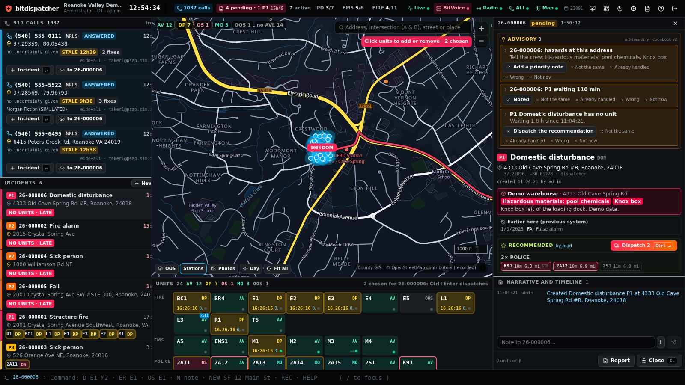
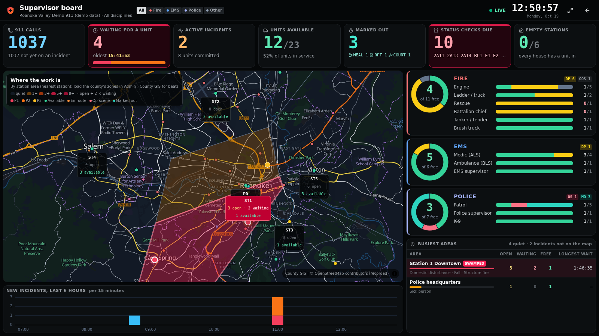
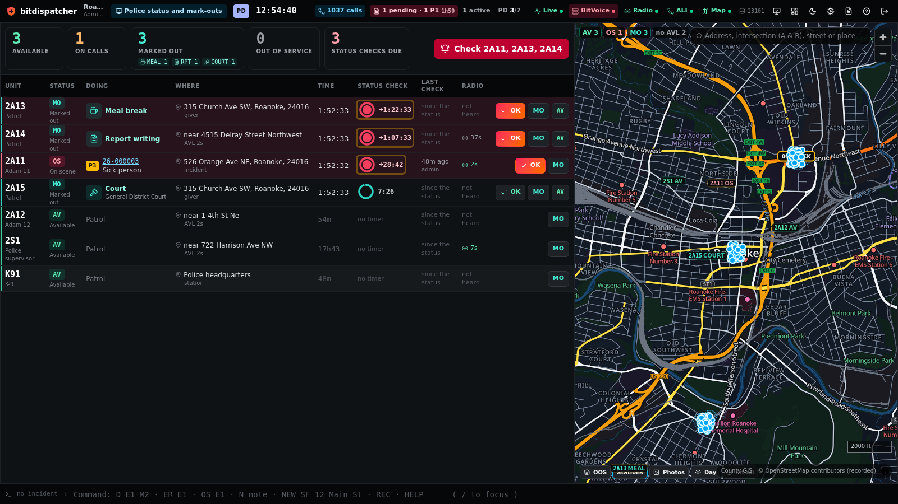
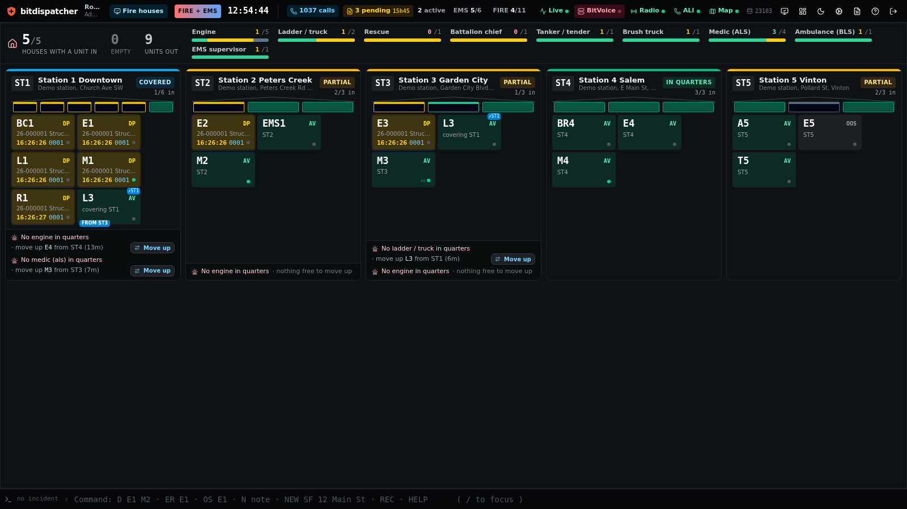
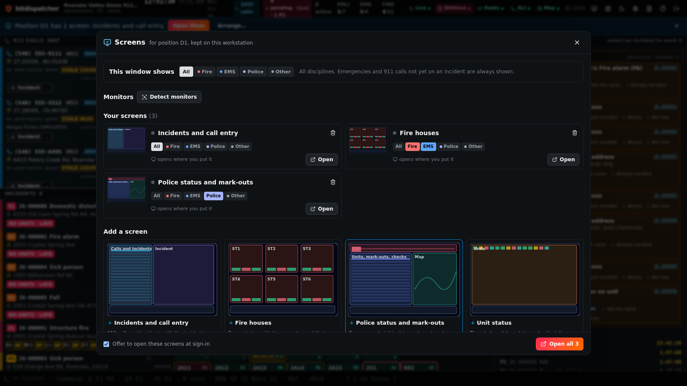
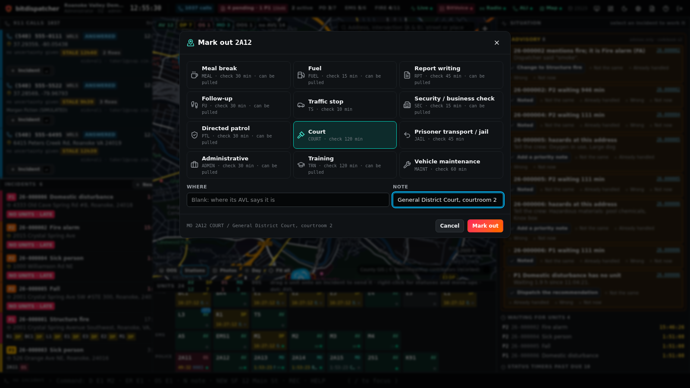
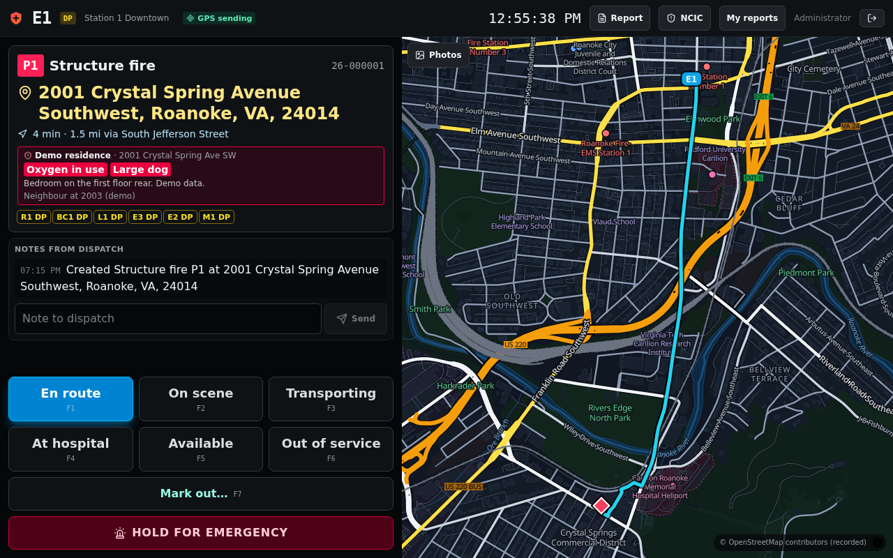
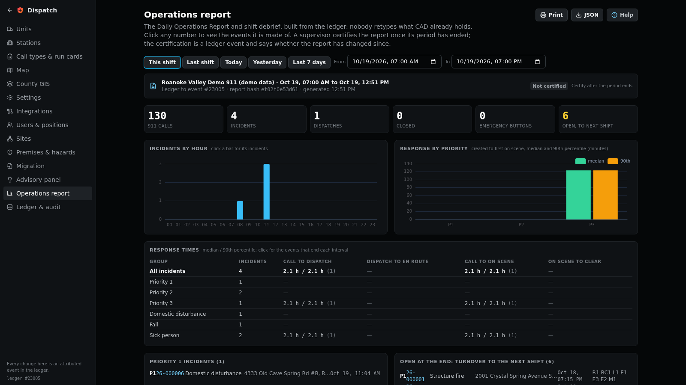
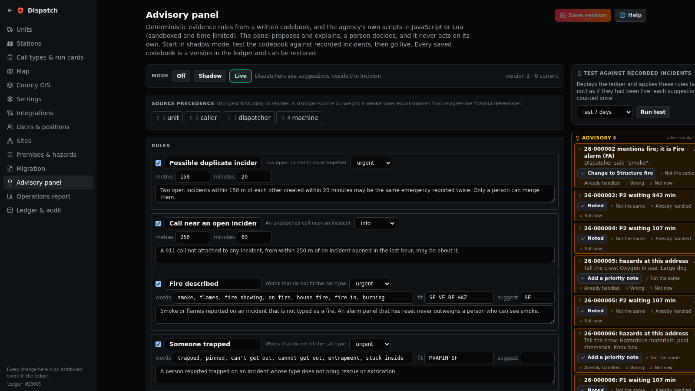

# bitdispatcher

### An open-source, single-binary 911 computer-aided dispatch (CAD) system

**A complete, Apache-2.0 licensed CAD for 911 centres and dispatch operations, run 100% from its web interface.** Incidents, unit recommendation by road time, a dispatch map that works with no internet, screens for every monitor at the console, mark-outs and status checks, a supervisor board, a mobile terminal for the crews, incident reports, NCIC inquiries and the state's crime reporting file. No per-seat licence. No server farm. No database to stand up first.

**One 35 MB file. 25 MB of memory at rest.** Start it, sign in, and a dispatcher has a working console; the map, the units, the run cards and everything else are set up from the browser.

[](LICENSE)
[](https://go.dev)
[](#status)
[](#build-and-run)
[](https://bitvoice.org)
[](https://github.com/biodream-llc/bitdispatcher/actions/workflows/ci.yml)

<p align="center">
<a href="https://demo.bitdispatcher.com"></a>
</p>

<p align="center"><sub><b>Press Sign in as the demo user</b>, or sign in as <code>demo</code> with password <code>try-bitdispatcher-demo</code> · choose any duty (call-taker, police, fire or EMS dispatcher, supervisor, records) on invented data around Roanoke, Virginia · simulated 911 calls arrive every 35 seconds · reset every night</sub></p>

<p align="center">
<a href="#build-and-run"></a>&nbsp;<a href="https://bitdispatcher.com/manual/"></a>&nbsp;<a href="https://bitdispatcher.com"></a>
</p>

<p align="center"><sub>No release yet: build it from source with one <code>make</code>. Launch state: <b>Virginia</b>.</sub></p>

[**What it does**](#everything-it-does) · [**What it looks like**](#what-it-looks-like) · [**Build and run**](#build-and-run) · [**With BitVoice**](#with-bitvoice-and-without-it) · [**How it is tested**](#how-it-is-tested) · [**Status**](#status) · [**Manual (PDF)**](docs/manual/bitdispatcher-manual.pdf) · [**FAQ**](#faq) · [**bitdispatcher.com**](https://bitdispatcher.com)

---

## What is bitdispatcher?

**bitdispatcher is the software a 911 dispatcher works in all shift.** A call comes in with the caller's location; the dispatcher makes it an incident, bitdispatcher recommends the closest right units by road, the dispatcher sends them with one keystroke, and every status, note and decision after that is kept in a ledger that cannot be quietly changed.

**It is built for the agencies the big CAD vendors price out.** Small and mid-size counties and cities need everything a large centre needs (fire, EMS and police together, move-ups, mark-outs, reports, NCIC, the state's crime file) done reliably, without a seven-figure contract and a server room. bitdispatcher is one program, free, with its source.

**100% in the web interface.** That is the first rule of the project. Units, stations, call types and run cards, the recorded map, county GIS, users and positions, integrations, the advisory codebook, agency scripts, settings: every one has a screen, and a feature that can only be reached through a file or the command line is treated as a bug. Every screen has a chapter in the built-in manual and automated browser tests.

**The dispatcher decides.** Recommendations, advisory checks and agency scripts advise; nothing dispatches, closes or changes the priority of an incident on its own.

**Standards at every boundary.** Caller location arrives as ALI spill, NENA i3 PIDF-LO or an EIDO incident from any call-handling system. With [BitVoice](https://bitvoice.org), BioDream's open-source phone system and 911 call handling, it uses every hook BitVoice offers a CAD; without it, it works on its own.

## Everything it does

Where something has been tested only against simulators or sample data rather than live systems, [it says so](#status).

**The dispatcher's console**
- The 911 call queue (ringing before answer), the incident queue with priority timers, the map, the incident panel and the unit status board on one screen; every part shows something the dispatcher acts on.
- A command line for everything (`D E1 M2`, `ER E1`, `OS E1`, `NEW SF 12 Main St`, `MO 2A12 MEAL`, `SC 2A12`), with completion, history and the reason shown when a command is refused; a ⌘K palette; drag a unit onto an incident to send it; a right-click menu on every unit.
- Run-card recommendation by capability and **road time**, counting units already on scene, flagging what is short and which stations would be left empty.
- Premises and hazards with every incident ("oxygen in use", "large dog", "Knox box"), and the address's history from the previous CAD.

**Call-taking and roles**
- Sign-in by duty: call-taker, police, fire or EMS dispatcher, all-discipline dispatcher, supervisor, administrator or records. Each opens its own workspace, and the server enforces what each duty may do.
- Workstations enrolled once by an administrator, so a computer signs in as its position; one-time codes from an authenticator app for everyone or for supervisors and administrators; the console locks with Ctrl+Shift+L or after a set idle time and unlocks for the same person.
- A call-taker's workspace with nine tabs (Call Entry, Persons, Vehicles, Previous, Hazards, CAD Search, Comments, History, Resources) and the call and narrative always beside them; F4 submits and keeps the incident open for more, F2 clears for the next call.
- Call types by code or word with CSV import, modifiers that raise the priority or add who to notify, the caller's own location when they are not at the incident, duplicates offered before a second incident is made, and newer caller locations offered to accept or keep.
- Resources: passages from the agency's approved policies and guides, quoted word for word with their version, and recorded on the incident when shown.
- Call-taking protocols the agency writes (questions to a determinant that sets the priority and gives the caller's instructions, answered on number keys), and a hook for licensed protocol software such as ProQA to report its determinant.
- Supplemental caller location by HELD from RapidSOS's clearinghouse or a state NG9-1-1 location server, automatically or with one press, offered like any newer location.
- Messages between dispatch and crews (to units, groups, everyone on an incident), urgent ones holding the top of the terminal until acknowledged; crews may take a waiting incident if the agency allows it.
- Alarm companies, plate readers, gunshot detection and cameras arrive as data calls in the queue, with the alarm company told when units are sent, arrive and clear; the alarm company's cancel goes on the incident. Each alarm company can have its own address and token; every alarm is checked against the agency's permit register and its address's false alarms in the last year; an alarm phoned in is typed on an alarm card with the same checks.
- Road closures drawn on the map (a stretch of road or a circle) and live traffic (Waze for Cities or any GeoJSON feed) change drive times and recommendations at once; crews see the closures and detours on the terminal.
- Cameras near an incident from the agency's own list, off until switched on, each opening asking why and recorded; bitdispatcher keeps no video.
- Automatic dispatch for the low-priority call types an agency chooses: the recommended units are sent when no dispatcher has within the wait, only when the recommendation is complete and has no warnings, and it is logged.
- For the dispatcher: the reason asked when units other than the recommended ones are sent, a confirmation for an unverified location, response plans with a due order, units flashed NO ACK when they do not acknowledge, talkgroups, a notification checklist, BOLOs, hospital diversion and a shift passdown log; a supervisor's exceptions panel.

**Screens for several monitors**
- Incidents and call entry, fire houses, police status and mark-outs, unit status, the map, the incident, and a supervisor board: each on its own monitor, opened with one click and remembered per console position.
- Each screen limited to fire, EMS or police if wished, with emergencies and unattached 911 calls always shown. Choosing an incident on one screen opens it on all the others.
- Monitors found with the browser's Window Management API, told apart by position, so two identical monitors are never confused.

**Fire, EMS and police**
- **Alarm levels:** 2nd and 3rd alarms (any number, per call type), each adding units to the run card; `ALARM` upgrades the incident and the recommendation fills the bigger card.
- **Fire-ground accountability:** a roll-call (PAR) clock that starts when the first unit arrives, crews reported missing in flashing red until found, and the commander's benchmarks with the elapsed time.
- **Crews and staffing:** the agency's roster with qualifications, who rides each unit this shift (set at the console or from the crew's terminal), minimum staffing, and a medic with no paramedic aboard not sent as ALS.
- **Paging volunteers and off-duty crews:** paging groups paged by hand or when their units, stations or call types are dispatched, by text (Twilio), email, push (ntfy), webhook, or IamResponding and Active911 by email; each person answers responding, to the scene or not available from a link, and the incident shows who is coming and when.
- **Tow rotation** by class and zone, with turns kept fair (a decline loses the turn; an owner's choice takes none).
- **Warrants and civil process:** papers to serve with the person, address, court and every attempt; an incident at the address of an active one says so, with its caution, to every console and the police crews.
- **Alerting the public:** shelter in place, evacuate, police activity, a missing child or 911 down, written by a supervisor with the phone text (90 characters), the area (around the incident, an area on the map, or everyone) and English and Spanish; approved by a second supervisor when asked; sent as CAP 1.2 to the IPAWS profile to sirens and alert software, in a public CAP feed, and by text, email and push to people who signed up, each only when they are inside the area; updates and the all-clear in one click.
- **Agencies:** every organisation dispatched for is a configured agency (identifiers, incident numbering, dispositions, timers, talkgroups), owning its units, stations, call types and response plans; people have the agencies they may work, their usual coverage loads at sign-in, the working agency is always shown, and incidents have a primary agency and assisting ones while every unit keeps its home agency. Configuration is published from the staging board per agency, with a reason, and can be rolled back. Someone limited to some agencies sees only their part of the shared board, enforced on the server.
- **Saved duty presets:** each person's workspace for each duty is kept with their account and opens at any console; it stays locked unless deliberately edited, saved and locked again; trainees work the agency's assigned preset; supervisory views are the agency's to give, and refused on the server without the right.
- **Working calls:** a call-taker keeps several calls in progress in tabs beside call entry (up to the agency's limit per duty), each its own draft kept on the server, recovered after an interruption; opening, moving, submitting and discarding each is recorded.
- **Messages and BOLOs:** an inbox inside CAD with subjects, kinds, four priorities with the agency's tones, repeats, acknowledgement and escalation, To and CC by agency, position, role, duty, person, unit or incident, attachments checked and hashed (and virus-scanned with ClamAV where set up), the words inside them searchable (text, PDFs, and pictures with Tesseract where installed), effective and expiry dates, versions for updates and cancellations, and receipts by person and duty.
- **Search and unit recall:** one permission-aware search across incidents, messages and BOLOs, people, vehicles, attachments and units that says why each result matched and how strongly, keeps possible matches apart from confirmed ones and is recorded; a unit's statuses, crews, incidents, messages and locations over any period in one timeline.
- **Staffing and qualifications:** who is on duty and on each unit in which position, sign-on by the crew (with approval where the agency wants it) or by dispatch, relief and moves without gaps, one person on one unit unless a secondary assignment is recorded, units left short limited or out of service unless a supervisor overrides, crews kept on incidents as they were; each agency's teams, specialties, training roles and credentials with expiry, verification and equivalencies, so a unit's capability comes from the qualified people aboard.
- **Mark-outs with a limit:** a unit out longer than its mark-out allows shows OVER on the boards and the supervisors are told once.
- **Keys and one-line commands:** key profiles per duty and screen, including a PremierOne-style classic layout with Shift keys; F7 makes a traffic stop from `UNIT1.8TH/STEWART..ABC1234` and F11 a status from `UNIT1.AS`, in the agency's own order and codes, with refused and retired codes recorded.
- **Station alerting:** a dispatch tones out each station of the units sent, on a station screen (rising tones, the call read aloud twice, acknowledge) and to a station alerting controller.
- **Fire houses:** every station as a card with its bays, what is in quarters, covering units and gaps, with a one-click move-up by road time.
- **Police mark-outs:** meal, fuel, report writing, follow-up, traffic stop, business check, court, jail and more (the agency's own list), each with where the officer is and its own status-check timer; overdue checks flash; `SC` clears them in one keystroke; interruptible mark-outs are offered when no car is free.
- **Supervisor board:** what is free, what is waiting, status checks due, empty stations, and where the work is piling up, shaded by county zone or station area.

**The map, with no internet**
- OpenStreetMap recorded for a circle around the centre (100 miles by default) into bitdispatcher's own store: a night and day dispatch map, road routing, address, intersection and landmark search.
- County GIS (address points, hydrants, zones, place names) from ArcGIS REST or GeoJSON, searched first; Virginia's statewide address points are a preset. Centreline ranges and Overture's open addresses fill in the gaps.
- Aerial photos recorded in tiers (Virginia's VBMP, USGS elsewhere) under the map, on the console and the mobile terminal.
- Views of a place from every side: the four oblique aerial photos (north, east, south, west) from the agency's own EagleView licence, street photos that look at the place from Panoramax or Mapillary, and the agency's own pre-plan photos of each premise, taken by crews from the mobile terminal. On the incident, in the call-taker's Hazards tab, on the terminal and from a right-click on the map; each says where and when it was taken. Buildings in 3D from OpenStreetMap.

**Planning and the numbers to call**
- **Scheduled calls and special events:** incidents made by themselves at their time (with their units, when available), events listed while they run, repeating daily, on weekdays or weekly.
- **The contacts directory and on-call lists:** utilities, agencies and the people on call tonight, on each incident's call-out list by call type with the number to call and a log of each call.
- **Areas on the map (geofences):** alerts when units enter or leave an area, and caution notes on every incident inside one.
- **A unit's status history** for any day from the ledger, with time committed and a CSV.
- **Patient-care reports:** each EMS unit's times and scene as a NEMSIS 3.5 record, downloaded or sent to the agency's ePCR system when the unit clears.

**In the field**
- A mobile data terminal for crews: assignment, route, premises, notes, one-tap statuses on F-keys, mark-outs, GPS, and the emergency button.
- The messages, BOLOs and officer-safety notices addressed to the crew or its agency's terminals, highest priority first, with the agency's tones, repeats and acknowledgement as on the console; opening and acknowledging are recorded.

**Records and reporting**
- Incident reports with the NIBRS data elements checked and supervisor approval; Virginia's incident-based reporting file for the month in one click; a first narrative drafted from the incident's record (or the agency's language model, from the same facts) for the writer to correct and finish.
- Fire and EMS incidents sent to NERIS, the national fire reporting system, on close or by a press.
- Files and photos on an incident (from the console or a crew's camera), each with its SHA-256 in the ledger; a supervisor hides one with why, never deletes it.
- A closed incident's record corrected without reopening it (type, priority, disposition, address, unit times), with what each was and why; any incident replayed on the map from the ledger.
- NCIC inquiries through the state's switch or a training simulator, logged with purpose and reason.
- The Daily Operations Report and shift debrief, built from the ledger, with drill-down and supervisor certification.

**Assisting the dispatcher**
- An advisory panel: deterministic evidence rules from a versioned codebook (possible duplicate, a call near an open incident, fire described on a non-fire call, hazards at the address), in shadow or live mode, tested against recorded incidents first.
- Agency scripts in JavaScript or Lua, sandboxed and time-limited, for incidents, recommendations and reports; advice only.

**The call, without the typing**
- A live transcript of each call (from BitVoice or any speech-to-text engine), with the address, weapons, vehicles, plates, direction of travel, people and injuries pulled out by rules; urgent ones in red, the address placed with one press.
- Spanish callers translated line by line by a built-in emergency phrasebook (it says when it has only the gist), ready reply phrases in the caller's language, texted or spoken aloud; an optional language model of the agency's choosing for the rest.
- Twelve more languages offline (Arabic, Chinese, French, Haitian Creole, Hindi, Japanese, Korean, Polish, Portuguese, Russian, Tagalog, Vietnamese): recognised from the caller's words, the gist of each line, and the ready phrases said in the language. Machine-written phrasebooks, not checked by native speakers.
- A location link for a call with no usable position: texted or read to the caller, it sends the phone's own location to the call while the caller shares it.
- A non-emergency intake for a voice or text bot on the non-emergency line: the agency's questions, any emergency handed to a call-taker at once, the report waiting in the non-emergency list for a person.
- Self-service setup with remote support: a setup checklist worked out from the configuration, a go-live check (the ledger, a restore, a test call of every call type at every station that writes nothing, the connections), and a support bundle with no secrets and no caller data that the administrator downloads and decides whether to send. bitdispatcher sends nothing anywhere by itself.
- The phone's own device location and floor (altitude), and a trail for a caller on the move; several callers about one fire grouped and attached in one step; non-emergency calls kept to one side, with a person always deciding.
- Vehicle crash notifications rated for injury risk by delta-V and rollover, with the response to consider (an electric car flagged for the fire crews); drones launched by rule or by a press, flying on the map; radio transmissions' words on the incident; every incident summarised in a paragraph for the crews.

**Reviewing and releasing the record**
- Review views of each incident (as first entered, summary, detailed, and a full audit with the ledger checked), printed or downloaded, every opening recorded.
- Records requests: redactions proposed by the agency's own rules, accepted or rejected one by one, released only on a person's approval, made permanent, checked for leaked text, with due dates in working days.

**Looking after the people**
- Critical calls (a cardiac arrest, a child, an officer down) put everyone who worked them on the supervisor's care list: a break offered, a debrief arranged, and a quiet word on their own console afterwards.
- Breaks and workload on the supervisor board, with who is free to relieve; a quality review of every incident against the centre's standards and the questions heard on the transcript.
- A training environment with scripted scenarios on the agency's own map and units, scored, never touching the live board; shared exercises where everyone who joins works one board while an instructor injects callers, location changes and radio traffic; configuration changes tried on a training board and published to the live one with a reason.
- Working through an outage from the last board with an offline log sent when the server is back, and a warning of telephony denial-of-service floods.

**Working with others**
- Incidents sent to and received from neighbouring agencies' CADs as NENA EIDOs, each agency with its own address and tokens; what arrives is a call in the queue.
- A public incident feed for a website or apps such as PulsePoint: hundred-block addresses, points to about 100 m, never callers or notes; off until turned on.

**Built to keep running**
- An append-only, SHA-256 hash-chained event ledger, verified and searched from the browser.
- Several sites active-active, each keeping a verified copy of the others' ledgers; each keeps working when cut off.
- Migration of an earlier CAD's premises, history and run cards from its CSV exports.
- The manual built in: Help on every screen, served at `/manual` and printed as a PDF.

## What it looks like

Everything below ships inside the binary, shown with the Roanoke demonstration data.

**The console:** the call and incident queues, the map with the caller, the incident with its hazards, advisory checks and the units recommended by road.



**The supervisor board:** totals across the top, where the work is on the map, each discipline's units, and the busiest areas.



**Police status and mark-outs:** what every car is doing, where, and when it is due a status check.



**Fire houses:** each station's bays, what is in quarters, who is covering, and the move-ups.



**Screens:** a layout for each console position, one screen per monitor.



**Marking a unit out**, with where and a note.



**The mobile terminal** on a crew's tablet.



**The operations report** and **the advisory panel**.





## Build and run

Go 1.26 or newer, and Node 24 with corepack (pnpm) for the web interface.

```sh
git clone https://github.com/biodream-llc/bitdispatcher && cd bitdispatcher
make web build sim
./bin/bitdispatcher -demo      # https://localhost:8443; the first start prints the admin password once
./bin/bvsim                    # optional: a simulated BitVoice with 911 calls and radio traffic
```

**A lab NG9-1-1 caller.** `go build -o bin/i3caller ./cmd/i3caller` builds a test tool for a lab call-handling system (never a real 911 line). It places NG9-1-1 calls over SIP with a PIDF-LO location, RFC 7852 Additional Data and a STIR/SHAKEN verstat, as G.711 voice (a tone, or a recorded sentence with `-wav`) or MSRP text, with a lab phone that answers and can transfer (`-phone`, `-transfer`), and serves the location by reference so each rebid finds the caller about 40 m further on. It can also stand in for a call-taker's phone (`-phone EXT -secret-file F`), a P25 radio system's home RFSS making an emergency call (`-radio host:port`), or the ESInet at a trunk's address answering keepalives (`-esinet host:port`). For text on a voice call it types as a TTY (`-tty`), as real-time text (`-rtt`) or by SIP MESSAGE (`-sipmsg`), and reads the call-taker's replies; `-noloc` places a call that brings only its number. It can also be a lab ALI database (`-alidb host:port`) or a lab PSAP on the ESInet that reports its queue and service state (`-site host:port -queue Full`). `i3caller -h` lists every option.

`-demo` adds fictional stations and units around Roanoke, Virginia, labelled as demo data. Then, in the browser:

1. **Admin › Map:** record the map for your area (the centre and radius are chosen on the map).
2. **Admin › Units, Stations, Call types & run cards:** your agency.
3. **Admin › Integrations:** BitVoice or another call-handling system; for the simulator, `https://127.0.0.1:9444` with the token `bv_simulated`, and press *Read it* to pin its certificate.

`-hooks-addr 127.0.0.1:PORT` takes BitVoice's EIDO and radio pushes over plain HTTP on loopback, when both run on one computer. `bitdispatcher -data <dir>` chooses where the ledger, users and recorded map live; `-tls-cert` and `-tls-key` use your own certificate instead of the self-signed one; `bitdispatcher reset-password <user>` sets a new password from the command line.

**Memory.** 25 MB at rest with the demonstration units and no recorded map. With a 100-mile recorded map (about 620 MB on disk), aerial photos and county GIS loaded, about 500 MB.

## With BitVoice and without it

bitdispatcher takes caller location from any standards-compliant call-handling system: **ALI spill** over TCP or serial, **NENA i3 PIDF-LO**, and **EIDO** incidents (NENA-STA-024).

With [BitVoice](https://bitvoice.org) it also uses BitVoice's live event stream (calls ringing before answer, rebids, caller photos), sends EIDO both ways, texts the caller and takes text-to-911 calls, sends a video link and shows live video (blurred until revealed), shows whether the caller's number was verified (STIR/SHAKEN), checks the caller's address against BitVoice's address data (LVF), shows BitVoice's check of a rebid location, keeps callers' photos as evidence (hash, the camera's time and GPS; each look recorded, naming the dispatcher in BitVoice's records too), takes radio emergencies and acknowledges them both ways, shows unit positions from the radio system, and puts BitVoice's answer times, exposure record and i3 log beside CAD reports. The full list is in [docs/BITVOICE.md](docs/BITVOICE.md). BitVoice is never required.

## How it is tested

- `make check`: gofmt, `go vet` and the Go unit suites (the ledger, the state rebuilt from the ledger equals the live state, recommendations, mark-outs, the map importer and router, NIBRS and the Virginia file, scripts, sites).
- `make web-test`: the web unit tests, including the manual checked against the screens.
- `make e2e`: Playwright against a real bitdispatcher with demo data and the BitVoice simulator: sign-in, call to incident to dispatch, emergencies both ways, call entry by a call-taker, the console lock, review views and a records request, a caller's photo kept hidden until revealed and recorded, the mobile terminal with messages and photos, call-taking protocols, a correction and a replay of a closed incident, mark-outs and status checks, and **three emulated monitors**, each screen landing on its own, the selection shared across windows.
- Golden files for i3 and EIDO generated by BitVoice's own encoder.

## Status

**Version 0.0.0: built and tested, not yet in service anywhere.** It is on a lab and design-partner track, like BitVoice's public-safety side. Before a centre relies on it:

- **Not certified.** Not CJIS-audited, no VCIN certification yet, and the Virginia IBR file has not yet been accepted by the State Police.
- **Tested against simulators and samples:** NCIC (our own training simulator; no outside NCIC or Nlets simulator was reachable), ALI (sample spills), the NIBRS file in the FBI's layout against SEARCH's NIBRS Pre-Certification Tool validator (`scripts/nibrs-validator.sh`), and public alerts against Google's CAP library with its IPAWS profile (`scripts/cap-validator.sh`) and EAS Station's feed reader (`scripts/eas-station.sh`). None of these is certification, and no alert has been sent to IPAWS.
- **Tested against a live BitVoice** in a lab, with `cmd/i3caller` placing the NG9-1-1 calls and standing in for the radio system: what works end to end, and what is built but not yet exercised (CAMA, which needs a T1 card), is in [docs/BITVOICE.md](docs/BITVOICE.md) section 6.
- **Multiple monitors** tested with Chrome's emulated monitors, not yet on a real console's monitors.
- **Transcripts** tested live with BitVoice's own speech-to-text (a recorded caller); **crash data and drones** tested with the simulator's crash notifications and drone system, not yet a telematics provider or drone system. The phrasebook translates the language of emergencies, not everything; the injury-risk rating and the quality review are aids, not judgements.
- **Sign-in and records.** The one-time codes, console lock, sign-in notice and audit records have not been reviewed against the CJIS Security Policy; there is no FBI certification for software. bitdispatcher can be built with the Go Cryptographic Module v1.0.0, which holds FIPS 140-3 certificate #5247 (`make fips`), and its Go tests and browser suite pass in FIPS 140-only mode; that module validation is not a certification of bitdispatcher (see [docs/COMPLIANCE.md](docs/COMPLIANCE.md#fips-140-3)). Every CI run also checks the Go code, its modules, the standard library and the web packages for known vulnerabilities (govulncheck, pnpm audit). What it does towards each control, and the gaps, are in [docs/COMPLIANCE.md](docs/COMPLIANCE.md). Supplemental location by HELD (RapidSOS's clearinghouse or a state LIS) and the location hook are tested against stand-ins, not RapidSOS itself ([docs/SUPPLEMENTAL-LOCATION.md](docs/SUPPLEMENTAL-LOCATION.md)). The sample redaction rules and example guidance are placeholders, not legal advice or approved text; the optional language model for redactions is off by default and, when on, sends the record's text to that model. The training board is not a backup.
- **Views.** EagleView is built to its published Imagery API and tested against a stand-in, not yet against EagleView itself (that needs an agency's licence or EagleView's sandbox credentials). Panoramax is tested live; Mapillary against a stand-in. Looking a place up tells the provider where the incident is, so each provider is off until an administrator turns it on.
- **New integrations, tested against stand-ins only:** NERIS (its test environment needs an agency's credentials), neighbouring agencies' CADs (bitdispatcher to bitdispatcher, not another vendor's CAD), station alerting controllers, alarm companies (a JSON contract; the APCO/CSAA ASAP standard is not implemented because its schema is not public), plate readers and gunshot detection (a JSON contract, not Flock's or SoundThinking's own APIs), ProQA (a determinant hook, not a certified ProQA interface), PulsePoint (a documented feed, not PulsePoint's partner interface). Auto-dispatch is off for every call type until an administrator turns it on. See [docs/ALERTS.md](docs/ALERTS.md), [docs/CAD-TO-CAD.md](docs/CAD-TO-CAD.md), [docs/STATION-ALERTING.md](docs/STATION-ALERTING.md), [docs/PROTOCOLS.md](docs/PROTOCOLS.md), [docs/PUBLIC-FEED.md](docs/PUBLIC-FEED.md).
- **The roadmap features (alarms, crews, roll calls, paging, tows, schedule, directory, areas, unit history, patient-care reports, warrants)** are tested in the browser and against stand-ins: paging against stand-ins for Twilio, ntfy, email and a webhook (the demonstration uses a simulated pager whose simulated responders answer), not certified by IamResponding or Active911; the NEMSIS record checked against the NEMSIS 3.5.1 schema for the sections it carries and sent to a stand-in, not to a vendor's ePCR.
- **The operational updates (agencies, presets and views, working calls, messages and BOLOs, search and recall, staffing and qualifications, keys and one-line commands)** are tested in the Go suites and in the browser against the built-in simulators; the attachment virus scan was run against ClamAV 1.5.4's clamd with its full signatures (a clean file passes, the standard EICAR test file is refused on both kinds of upload); the agency-scoped board is tested through the API; the mobile terminal's messages and BOLOs (tone, open and acknowledgement by the crew) are tested in the browser; the priority tones are measured as rendered by Chromium's audio engine (rhythm, level, no clipping) and have not been judged by ear on a dispatch floor; OCR was checked with Tesseract 4 on a rendered plate picture, and PDF text on a Chrome-made PDF. The classic key layout follows PremierOne's documented defaults; it is not a Motorola product or certified by Motorola.
- **The October 2026 additions (road closures and live traffic, cameras near an incident, location links, alarm companies and permits, twelve more phrasebook languages, the non-emergency intake)** are tested in the Go suites, through the API against stand-ins (a stand-in Waze for Cities feed, a stand-in camera's picture, a stand-in bot on the intake) and in the browser (an emulated phone sharing its location, the alarm card, the intake try-out, a camera opened with its reason). Not yet against a real Waze feed, camera system, central station, voice bot or phone on a carrier network; the phrasebooks were written by machine and have not been checked by native speakers.
- **Self-service setup** (the setup checklist, the go-live check, the support bundle) is tested in Go (the checklist follows the configuration, the go-live check writes only its own result and leaves no test incident, the bundle holds none of a set of planted secrets, numbers, addresses and usernames) and in the browser. No agency has yet set bitdispatcher up by itself from start to finish.
- **Open decisions:** when an ALI-only call (no hang-up signal) should end; whether agency scripts may reach outside the sandbox; VGIN's terms for its data outside Virginia.

See [docs/DESIGN.md](docs/DESIGN.md) for the design, the rules and the phases, and [docs/OPERATIONS.md](docs/OPERATIONS.md) for the ledger and how reports count.

## The technology, explained

One article for each technology inside bitdispatcher: what it is, the standard behind it, where dispatch systems usually fall short, how bitdispatcher does it, and how far that has been tested. They are on [bitdispatcher.com/tech](https://bitdispatcher.com/tech/); the sources are in [site/articles](site/articles).

| | |
|---|---|
| [**Command line and keys**](https://bitdispatcher.com/tech/command-line-and-keys/) | A keyboard-first console: one-line commands, duty-specific key profiles, and a PremierOne-style classic layout. |
| [**Units by road time**](https://bitdispatcher.com/tech/road-time-recommendation/) | Recommend the right units by capability and real driving time, counting who is on scene and what runs short. |
| [**Closures and traffic**](https://bitdispatcher.com/tech/road-closures-and-traffic/) | Close a road from the map or set a radius, and drive times and unit recommendations go around it at once, with optional live traffic. |
| [**Multiple monitors**](https://bitdispatcher.com/tech/multi-monitor/) | A screen per monitor, found with the Window Management API, selection synced, and layouts remembered per position. |
| [**Many agencies, one floor**](https://bitdispatcher.com/tech/multi-agency/) | A consolidated center dispatches for many agencies, each with its own numbering, units and board, enforced on the server. |
| [**Messages and BOLOs**](https://bitdispatcher.com/tech/messages-and-bolos/) | An inbox inside CAD with four prioritized tones, acknowledgement, escalation, hashed and virus-scanned attachments, and versions. |
| [**Search and unit recall**](https://bitdispatcher.com/tech/search-and-recall/) | One search across incidents, BOLOs, people, vehicles, attachments and units, with match reasons, partial plates, and a unit recall timeline. |
| [**NG9-1-1 and EIDO**](https://bitdispatcher.com/tech/nena-i3-eido/) | How calls reach the CAD over an ESInet with i3 location and EIDO, and move on to the field and to neighbours. |
| [**Caller location**](https://bitdispatcher.com/tech/caller-location/) | ALI/ANI, wireless Phase I and II, device-based hybrid fixes, HELD, altitude and trails for moving callers. |
| [**Location links**](https://bitdispatcher.com/tech/location-links/) | When a call has no usable location, text the caller a link; one tap shares the phone's own GPS to the call. |
| [**Transcripts and translation**](https://bitdispatcher.com/tech/transcripts-and-translation/) | Transcribe the call live, pull out the facts by rule, translate Spanish callers line by line, and give the gist in twelve more languages. |
| [**Alarms and permits**](https://bitdispatcher.com/tech/alarms-and-permits/) | Each alarm company gets its own address and token; alarms arrive matched to a permit and the address's false-alarm count. |
| [**Cameras near**](https://bitdispatcher.com/tech/cameras-near-an-incident/) | The agency's own camera list, offered near an incident, off until switched on, with a required reason recorded for every look. |
| [**Crash data and drones**](https://bitdispatcher.com/tech/crash-and-drones/) | Rate crash severity from telematics by delta-V and rollover, flag electric vehicles, and launch a drone by rule or a press. |
| [**Offline map**](https://bitdispatcher.com/tech/offline-map/) | OpenStreetMap, routing and county GIS recorded into the binary, so the map still works with no internet. |
| [**Aerial imagery**](https://bitdispatcher.com/tech/aerial-and-oblique-imagery/) | Orthophotos, EagleView obliques, Panoramax and Mapillary street photos, and crews' own pre-plan photos. |
| [**Mobile data terminal**](https://bitdispatcher.com/tech/mobile-data-terminal/) | A browser terminal for crews: assignment, route, premises, one-tap statuses, GPS, an emergency button, and acknowledged messages. |
| [**Staffing and qualifications**](https://bitdispatcher.com/tech/staffing-and-qualifications/) | Who is on duty and on each unit, sign-on and relief without gaps, double-assignment blocked, and live capability from the crew aboard. |
| [**Station alerting and paging**](https://bitdispatcher.com/tech/station-alerting-and-paging/) | Tone out the firehouse and page volunteers by text, email, push and webhook, with responders answering from a link. |
| [**Non-emergency intake**](https://bitdispatcher.com/tech/non-emergency-intake/) | A script takes a non-emergency report through a voice or text bot, and hands any emergency to a call-taker at once. |
| [**Self-service setup**](https://bitdispatcher.com/tech/self-service-setup/) | A setup checklist, a go-live check and a support bundle, so an agency can set bitdispatcher up itself and get help remotely. |
| [**Public alerts (CAP, IPAWS)**](https://bitdispatcher.com/tech/public-alerting-cap-ipaws/) | Write a public warning once and send it as CAP 1.2 to IPAWS, sirens, alert software and subscribers in English and Spanish. |
| [**Public incident feed**](https://bitdispatcher.com/tech/public-incident-feed/) | Share open incidents with a website or apps like PulsePoint using hundred-block addresses and coarse points, never callers or notes. |
| [**NIBRS reporting**](https://bitdispatcher.com/tech/nibrs-reporting/) | Incident reports with the FBI's NIBRS data elements checked, supervisor approval, and Virginia's monthly IBR file in one click. |
| [**NERIS and NEMSIS**](https://bitdispatcher.com/tech/neris-and-nemsis/) | Fire incidents to NERIS on close, and NEMSIS 3.5 patient-care times from every EMS unit to the agency's ePCR system. |
| [**NCIC**](https://bitdispatcher.com/tech/ncic/) | Wanted-person, vehicle, gun and article inquiries through the state message switch, each with a purpose and reason in the ledger. |
| [**Records requests**](https://bitdispatcher.com/tech/records-requests/) | FOIA requests for 911 data: redactions proposed by the agency's rules, accepted one by one, released only on approval. |
| [**Event ledger**](https://bitdispatcher.com/tech/event-ledger/) | An append-only, SHA-256 hash-chained record of every action, so the day cannot be quietly rewritten. |
| [**Security**](https://bitdispatcher.com/tech/security/) | How a CAD is secured: duty-based access, enrolled workstations, one-time codes, a hash-chained audit ledger and scanned attachments. |
| [**Active-active sites**](https://bitdispatcher.com/tech/active-active-sites/) | Several sites all live at once, each holding a verified copy of the others' ledgers, each able to keep dispatching alone through an outage. |
| [**Scripts and advisories**](https://bitdispatcher.com/tech/scripts-and-advisories/) | Sandboxed agency scripts in JavaScript and Lua, and an advisory panel of deterministic rules from a versioned codebook, tested first. |
| [**Training and staged changes**](https://bitdispatcher.com/tech/training-and-staged-changes/) | A scored training board on the agency's own map, instructor-led exercises, and config changes tried on a training board before publishing. |
| [**Responder wellbeing**](https://bitdispatcher.com/tech/responder-wellbeing/) | Critical calls put everyone who worked them on the supervisor's care list for a break and a debrief, with workload and quality on the board. |
| [**Migration**](https://bitdispatcher.com/tech/migration/) | Bring premises, address history and run cards from CSV exports, and run alongside the old CAD until the floor is ready. |

## Documentation

| | |
|---|---|
| [**Manual (PDF)**](docs/manual/bitdispatcher-manual.pdf) | Every screen, with worked examples. Also `docs/manual/index.html`, and served at `/manual` and under Help by a running instance |
| **Manual in other languages** | [Dansk](https://bitdispatcher.com/manual/da/), [Deutsch](https://bitdispatcher.com/manual/de/), [Español](https://bitdispatcher.com/manual/es/), [Suomi](https://bitdispatcher.com/manual/fi/), [Français](https://bitdispatcher.com/manual/fr/), [Italiano](https://bitdispatcher.com/manual/it/), [Norsk bokmål](https://bitdispatcher.com/manual/nb/), [Nederlands](https://bitdispatcher.com/manual/nl/), [Polski](https://bitdispatcher.com/manual/pl/), [Português](https://bitdispatcher.com/manual/pt/), [Svenska](https://bitdispatcher.com/manual/sv/): translated by machine from the English (`docs/manual/i18n`), not yet checked by native speakers; the English is the reference. A chapter changed since its translation is shown in English until it is updated. Built in, under `/manual/<language>/` |
| [**Design**](docs/DESIGN.md) | What bitdispatcher is, its rules, its scope and the phases |
| [**Operations**](docs/OPERATIONS.md) | The event ledger, the reports and their counting rules |
| [**BitVoice**](docs/BITVOICE.md) | Every BitVoice hook and how bitdispatcher uses it |
| [**Compliance**](docs/COMPLIANCE.md) | What can be certified, the CJIS control areas, what bitdispatcher does and the gaps |
| [**Integrations**](docs/) | Alerts, CAD-to-CAD, station alerting, protocols, the public feed, supplemental location, NERIS, views |

## FAQ

**Is bitdispatcher really free? What is the licence?**
Yes. **Apache License 2.0**: commercial use, modification, distribution and private use are all permitted, with no fee and no per-seat or per-console pricing. See [LICENSE](LICENSE) and [NOTICE](NOTICE).

**What is BitVoice?**
[BitVoice](https://bitvoice.org) is BioDream's other free, open-source program (Apache 2.0): a complete phone system in one program, run from a web page, with extensions, queues, voicemail, recording, trunks and desk phones, as an alternative to FreePBX and Asterisk. It also has a 911 answering-point profile (NG911 calls with location, ALI and EIDO to a CAD, text to 911, caller video, speech-to-text) and a P25 radio console; like bitdispatcher, those public-safety parts are in the lab, not certified and not yet in service. In a 911 centre, call handling answers the call and the CAD sends help: BitVoice can be the first, bitdispatcher is the second. Source: [github.com/BioDream-LLC/bitvoice](https://github.com/BioDream-LLC/bitvoice).

**Do I need BitVoice?**
No. Any call-handling system that sends ALI spill, i3 location or EIDO works. BitVoice adds the live call stream, radio and video.

**Do I need the internet?**
No. The map, routing, address search, aerial photos and county GIS are recorded into bitdispatcher's own store and used locally. Outside the recorded area it can show online tiles, marked as such.

**Do I need a database or an application server?**
No. One binary; the ledger is a file and the recorded map is SQLite, both in its data directory.

**Can a demonstration server let visitors in with one click?**
Yes: tick **Public demonstration account** on a viewer, dispatcher or supervisor in Admin › Users, and the sign-in page offers **Sign in as the demo user**, with no password. Never an administrator; only for a server that is meant to be public.

**What is the demonstration running on?**
One Lightsail instance with 1 GB of memory, with the 100-mile recorded map, Virginia's address points and the aerial photos; the BitVoice simulator beside it sends the 911 calls, ALI and radio traffic. See [deploy/demo](deploy/demo/README.md).

**Can we use it in a live 911 centre today?**
Not yet: see [Status](#status). It is ready for a centre to try beside its current CAD, on training positions, with simulated and recorded traffic.

**Can we move from our current CAD?**
Admin › Migration takes an earlier CAD's premises, address history and run cards from CSV exports; the address history shows with every incident.

**How do I report a bug?**
Open a [GitHub issue](https://github.com/biodream-llc/bitdispatcher/issues) with the output of `bitdispatcher -version` and what you did. Never include real caller or incident data.

---

## Contributions are not accepted

This is deliberate, and it is not a judgement about anybody's code. bitdispatcher is developed and maintained by BioDream LLC, and it stays that way. **Pull requests will not be reviewed or merged.**

The reason is the subject matter. This software sends help to people in emergencies, and every behaviour has to be verified, recorded and explainable. That standard is slow to enforce across contributors, and a half-enforced standard in a 911 system is worse than none.

**Bug reports are wanted.** A clear report of something that does not work is more valuable here than a patch.

### What the licence permits regardless

Apache 2.0 gives you the right to use, modify and redistribute this software, and closing this repository to contributions does not take that away. You may take a copy, change it to suit you, and run or publish the result, commercially or otherwise.

## Licence

[Apache License 2.0](LICENSE). Copyright 2026 BioDream LLC. See [NOTICE](NOTICE) for the third-party components and data sources.

bitdispatcher is not affiliated with or endorsed by NENA, the FBI's CJIS Division, the Virginia State Police or VGIN. Those names are used only to describe the standards and data it works with.

**Keywords**

**Category:** computer-aided dispatch · CAD · 911 CAD · open source CAD · free CAD software · public safety software · emergency dispatch software · PSAP software · dispatch console · ECC software · emergency communications centre

**Dispatch:** fire dispatch · EMS dispatch · police dispatch · run cards · unit recommendation · AVL · move-up and cover · station status board · mark-outs · officer status checks · supervisor board · multi-monitor dispatch · mobile data terminal · MDT · MDC

**Standards:** NG911 · NENA i3 · EIDO · NENA-STA-024 · PIDF-LO · ALI spill · NCIC · NIBRS · Virginia IBR · VCIN · CJIS

**Map:** offline dispatch map · OpenStreetMap · road routing · county GIS · address points · hydrants · aerial imagery · VBMP · VGIN

**Deployment:** single binary · Go · Golang · Apache 2.0 · self-hosted · on-premise · air-gapped · Linux · macOS · Windows · Virginia
